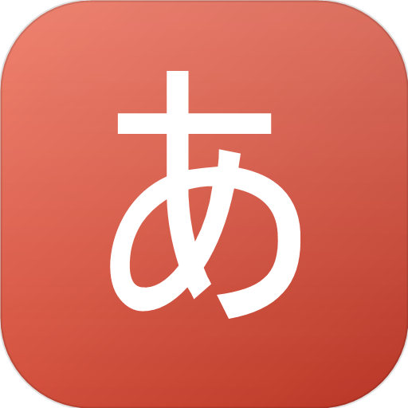

# Kotoba · 言葉

**English** · [Русский](README.ru.md)

## ⚠️ Important: development, authorship, and warranties

**This is a personal hobby project, not a commercial product and not an official release.**

- A significant portion of the code was written with AI tools — the so-called "vibe coding". I set the tasks, made the decisions, and reviewed the result, but I did not write every line by hand.
- I do not hide the use of AI and state it explicitly here so that no one gets the impression of deception.
- I do not claim authorship of every line of code and do not claim any patent rights to the project. The copyright notice in [`LICENSE`](LICENSE) refers to the project as a whole and does not mean that every fragment was written by me by hand.
- The code is provided "as is", without warranties. It may contain bugs, rough edges, and fragments of unclear origin.
- Original repository: https://github.com/gorechi/Kotoba. It is the source of truth; forks and copies must not be presented as the original.
- If you find third-party code, a font, an image, or any other material used without attribution or a license, please let me know — I will check it and either fix or remove it.
- Rights to third-party components belong to their authors and are governed by their licenses. The project is distributed under the **MIT** license; Klee One and Caveat are distributed under SIL OFL 1.1; the license texts are in `public/fonts/`.
- Please do not treat this project as legally vetted or commercially supported.

A simple desktop app for learning Japanese with flashcards. Hiragana and katakana are included; custom decks and cards can be added in a couple of clicks. Everything works offline, and progress is stored only on this computer.



## Features

- **Built-in decks**: hiragana and katakana, 71 cards each (46 basic characters + 25 voiced). Basic characters include example words.
- **Kana map**: a grid of hiragana and katakana with progress for each character, study status colors, and a mnemonic indicator. Clicking a character starts a session with just that card.
- **Kana mnemonics**: you can save a personal association for a character on the front of the card. It is hidden by default and opens when you click the lightbulb.
- **Custom decks and cards**: word or character, reading, translation, and a note. A deck can be renamed, recolored, and deleted.
- **Card tags**: tags can be added when creating or editing a card. As you type, the app suggests tags already used in the deck, so you don't have to remember the exact spelling. Tags are shown in the card list and can be used as filters.
- **Kana input without a Japanese keyboard layout**: type romaji and the field converts it to kana automatically. Use the `abc / あ / ア` toggles, the additional characters panel, and the "Add and add another" button to enter a batch of cards quickly.
- **Spaced repetition with a simplified SRS**: a card comes back after 10 minutes, 12 hours, 1 day, 3 days, and so on, depending on your rating. New cards are introduced in small batches to avoid overload.
- **Mistake review at the end of a session**: at the end of a session, the app shows the cards you marked "Again", with their reading, translation, and a "Listen" button. The "Review mistakes again" button starts a session with just those cards.
- **Undo the last rating**: if you press the wrong button, return to the card with the "Undo" button or `Ctrl+Z` — progress and statistics will be restored.
- **Text-to-speech**: the speaker button reads Japanese text using the system voice (Web Speech API, `ja-JP`).
- **Statistics**: streak, accuracy, 14-day review activity, and progress by deck.
- **Themes**: light, dark, or system.
- **Zen mode**: full-screen review with no interface. The card shows the Japanese side, flips to the translation after 10 seconds, and fades out and is replaced by the next card after another 10 seconds. The mode can be started from the menu or automatically after a configurable period of inactivity; exit with the button or `Esc`.
- **Backups**: JSON export and import, and progress reset.

## Adding cards

The "Word or character" field works in `あ` mode by default — type in Latin letters:

| Typed | Result |
| --- | --- |
| `mizu` | みず |
| `gakkou` | がっこう |
| `konnichiha` | こんにちは |
| `kan` + `Tab` | かん |
| `ko-hi-` in `ア` mode | コーヒー |

- `abc` — plain Latin input with no conversion;
- `あ` and `ア` — hiragana and katakana;
- below the field is a panel of `っ ゃ ゅ ょ ぁ ぃ ぅ ぇ ぉ ゔ ー` (in katakana — `ッ ャ ュ ョ … ヴ`);
- the reading is filled in as romaji automatically until you start editing it manually;
- "Add and add another" or `Ctrl+Enter` saves the card and keeps the form open for the next one.

## Tags and filters

The card form has a "Tags" field where you can add arbitrary labels (for example, `#noun`, `#verb`, `#N5`). As you type, the app suggests tags already used in the deck, so you don't have to remember the exact spelling.

On the deck page, filters appear above the card list:
- **Tags** — click a tag to show only cards with that tag. Multiple tags can be selected.
- **Status** — "All", "New", "Due", "Learned".
- **Search** — by word, reading, translation, note, or mnemonic.

## Development setup

Node.js 20+ is required (tested on 24 LTS).

```powershell
npm install
npm run dev
```

`npm run dev` starts Vite and the Electron window together. If you only need the browser:

```powershell
npm run dev:web
```

and open `http://localhost:5173`.

## Building the installer

```powershell
npm run dist
```

The installer will appear in `release\Kotoba-Setup-1.4.0.exe`. It is an NSIS installer: you can choose the installation folder, and a desktop shortcut is created.

Web build only (no installer):

```powershell
npm run build
```

The result is in the `dist` folder.

## Where data is stored

In the packaged app, data is stored in `%APPDATA%\Kotoba\`:

- `kotoba-content.json` — decks and cards;
- `kotoba-settings.json` — settings;
- `kotoba-progress.json` — SRS progress;
- `kotoba-history.json` — study history.

In browser mode, the app uses IndexedDB, with `localStorage` as an emergency fallback.

You can copy the files to another computer or import them via "Settings → Import". The "Data folder" button opens the folder in File Explorer.

## Study session hotkeys

| Key | Action |
| --- | --- |
| `Space` / `Enter` | flip the card |
| `1` | Again — the card will return after a few cards |
| `2` | Hard |
| `3` | Good |
| `4` | Easy |
| `Ctrl+Z` | undo the last rating |
| `Esc` | exit the session |

## Project structure

```
electron/          main process and preload (IPC, window, files)
src/
  components/      study card, decks, forms, modals
  assets/          bundled fonts and SVG masks
  data/            hiragana, katakana, and seed data
  lib/             SRS, statistics, study queues, data validation, romaji→kana
  pages/           Home, Decks, Statistics, Settings
  state/           data store and autosave
  styles.css       theme and all styles
scripts/           dev launcher and icon generation
build/             app icons
```

On load, data passes through `src/lib/normalize.ts`: corrupted or incomplete JSON is restored, built-in decks are put back in place, and progress is not lost.

## Fonts and licenses

The project code is distributed under the **MIT** license. The full text is in [`LICENSE`](LICENSE).

The app works offline and does not download fonts from the network — they are bundled into the build.

- **Klee One** — the Japanese side of cards in Zen mode. Author: The Klee Project Authors. License: SIL Open Font License 1.1. Font file: `src/assets/fonts/KleeOne-Regular.ttf`, license text: [`public/fonts/OFL-KleeOne.txt`](public/fonts/OFL-KleeOne.txt).
- **Caveat** — translations on Zen cards (Cyrillic and Latin). Author: The Caveat Project Authors. License: SIL Open Font License 1.1. Font file: `src/assets/fonts/Caveat-Regular.ttf`, license text: [`public/fonts/OFL-Caveat.txt`](public/fonts/OFL-Caveat.txt).

Both fonts are distributed under SIL OFL 1.1: they can be freely used, modified, and embedded in the app. The MIT license in [`LICENSE`](LICENSE) applies to the app code; it does not apply to the fonts.

## Ideas for future development

- Kanji and vocabulary decks with CSV import.
- Reverse mode: translation → Japanese.
- Custom intervals and SRS settings.
- Study reminders.
- Sync between devices.
