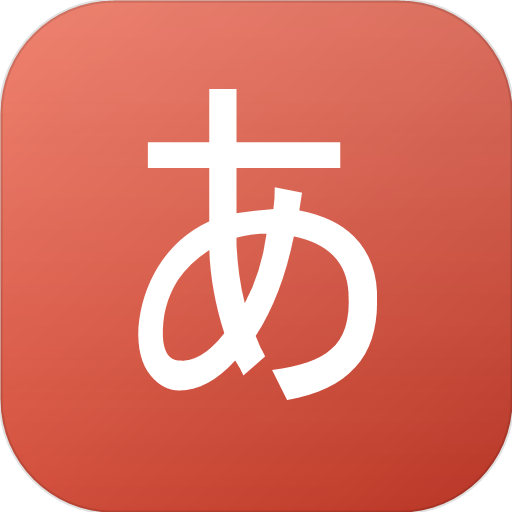

# Котоба · 言葉

[English](README.md) · **Русский**

<p align="center">
  
</p>

<p align="center">
  <strong>Спокойное настольное приложение для изучения японского по карточкам.</strong><br />
  Кана, кандзи N5/N4 и свои колоды — офлайн, приватно и всегда под рукой.
</p>

<p align="center">
  <a href="https://github.com/gorechi/Kotoba/releases/latest"></a>
  
  <a href="LICENSE"></a>
  
</p>

> **Котоба** (言葉) — «слова» по-японски. Это маленький спокойный помощник для учёбы: без аккаунта, ленты и уведомлений — только карточки, мягкие повторения и ваш собственный темп.

## Почему Котоба

- **Всё остаётся у вас.** Колоды, прогресс и история хранятся на вашем компьютере. Ничего не отправляется на сервер.
- **Работает офлайн.** Шрифты и данные карточек встроены в приложение; единственный сетевой запрос — проверка обновлений.
- **Мягкий ритм.** Новые карточки небольшими порциями, спокойные анимации и режим «Дзен» для повторения без лишнего интерфейса.
- **Легко подстроить.** Встроенные колоды готовы к учёбе, а свои колоды и карточки добавляются в пару кликов.
- **Три языка.** Интерфейс доступен на английском, русском и испанском и переключается в любой момент.

## Скачать

Последний установщик — на странице [GitHub Releases](https://github.com/gorechi/Kotoba/releases/latest):

- **Kotoba-Setup-1.8.0.exe** — установщик для Windows x64 (NSIS). Можно выбрать папку установки; ярлык на рабочем столе создаётся автоматически.
- Установщик не подписан, поэтому при первом запуске Windows SmartScreen может показать предупреждение.

Котоба также запускается в браузере для разработки — см. раздел «Запуск для разработки».

## Экраны одним взглядом

| Экран | Для чего |
| --- | --- |
| **Учить** | Повторения на сегодня, колоды и свои подборки |
| **Кана / Кандзи** | Встроенные и свои колоды с карточками |
| **Карточки** | Поиск, фильтры и порядок во всей коллекции |
| **Карта каны** | Прогресс по каждой хирагане и катакане |
| **Статистика** | Серия, точность, активность и прогресс по колодам |
| **Данные** | Импорт CSV/TSV и резервные копии |
| **Настройки** | Цели, оформление, темп, озвучка и обновления |
| **Помощь** | Пошаговые руководства |

## Что внутри

### Учёба

- **Встроенные колоды каны** — хирагана и катакана, по 71 карточке (46 базовых знаков + 25 озвончённых). У базовых знаков есть примеры слов.
- **Кандзи N5 и N4** — 103 кандзи N5 и 181 кандзи N4 с чтениями, значениями и до двух примеров слов. Значения и переводы следуют языку приложения. Встроенные карточки защищены от изменений; чтобы добавлять или менять карточки, создайте свою колоду кандзи.
- **Режимы «Чтение» и «Письмо»** — режим выбирается рядом с кнопкой «Учить». «Чтение» показывает японскую сторону и просит вспомнить чтение и значение; «Письмо» показывает значение и предлагает написать японский текст самому. Настройка «Нормальный/Сложный» определяет, видна ли транскрипция в режиме «Письмо».
- **Повторения по упрощённому SRS** — карточка возвращается через 10 минут, 12 часов, 1 день, 3 дня и дальше — в зависимости от оценки. Новые карточки вводятся небольшими порциями, чтобы не перегружаться.
- **Разбор ошибок** — в конце подхода показываются карточки, которые вы отметили как «Снова», с чтением, переводом и кнопкой прослушивания. «Проработать ошибки ещё раз» запускает подход только с этими карточками.
- **Отмена оценки** — нажали не ту кнопку? Вернитесь к карточке кнопкой «Отменить» или `Ctrl+Z`; прогресс и статистика восстановятся.
- **Режим «Дзен»** — полноэкранное повторение без интерфейса. Карточка показывает японскую сторону, через 10 секунд переворачивается с переводом, ещё через 10 секунд растворяется и заменяется следующей. Режим запускается из меню или автоматически после настраиваемого бездействия.
- **Своя подборка** — готовые наборы для просроченных и новых карточек, JLPT N5/N4, только кандзи, по тегу, марафона на 50 карточек и ошибок за неделю. Можно собрать и сохранить свой набор с фильтрами по колоде, типу, JLPT, тегу и размеру.

### Колоды и карточки

- **Свои колоды и карточки** — слово или знак, чтение, перевод и заметка. Колоду можно переименовать, сменить ей цвет и удалить в любой момент. Колоды каны и кандзи хранятся отдельно.
- **Ввод каны без японской раскладки** — набирайте ромадзи, и поле само превращает его в кану. Переключатели `abc / あ / ア`, панель дополнительных знаков и кнопка «Добавить и ещё» помогают быстро набрать пачку карточек.
- **Теги** — при создании или редактировании карточки можно добавлять произвольные метки. При вводе предлагаются теги, уже использованные в колоде; по тегам можно фильтровать.
- **Экран «Карточки»** — поиск, фильтры по колоде, типу, статусу, тегу и мнемонике, сортировка, перетаскивание карточек между колодами и массовые действия: перенос, приостановка, отметка «знаю», сброс прогресса, добавление тега и удаление.
- **Карта каны** — сетка хираганы и катаканы с прогрессом по каждому знаку, цветом изученности и значком мнемоники. Клик по символу запускает подход только с этой карточкой.
- **Мнемоники** — на лицевой стороне карточки каны можно сохранить личную ассоциацию для знака. Она скрыта по умолчанию и открывается по клику на лампочку.
- **Импорт CSV/TSV** — отдельные сценарии для каны и кандзи. Загрузите файл, выберите колоду или создайте новую и сопоставьте столбцы с полями карточки.

### Прогресс и комфорт

- **Статистика** — серия дней, точность, повторения за 14 дней, прогресс по колодам и разбивка практики чтения и письма.
- **Цели и темп** — дневная цель по повторениям или минутам, долгосрочные ориентиры по общему числу повторений, выученным карточкам и дням подряд, а также сколько новых карточек получает каждая колода в день.
- **Бережная запись прогресса** — ответы собираются в пачку и записываются на диск при паузе или выходе из подхода, поэтому учёба не перезаписывает файлы на каждой карточке.
- **Настройки колоды** — лимиты новых карточек и повторений, порядок карточек и режим изучения можно задать отдельно для каждой колоды.
- **Темы** — светлая, тёмная или системная.
- **Сворачиваемая боковая панель** — меню сворачивается в полосу с иконками, чтобы дать карточкам больше места. При наведении на иконку появляется название пункта; состояние панели сохраняется между запусками.
- **Озвучка** — кнопка с динамиком читает японский текст голосом системы (`ja-JP`). Нужен японский голос в Windows: Параметры → Время и язык → Язык и регион → добавить японский язык с компонентом речи. Если японского голоса нет, приложение показывает подсказку вместо воспроизведения неправильным голосом.
- **Помощь** — девять дружелюбных руководств в разделах **«Система»** и **«Обучение»**: озвучка, импорт и экспорт, импорт CSV, настройка системы, свои подборки, экран «Карточки», карточки каны и кандзи, режимы чтения и письма.
- **Проверка обновлений** — Котоба проверяет GitHub Releases при запуске и из «Настроек». Если новая версия найдена, в настройках появляется значок **«Доступно обновление»** и ссылка на страницу релиза. Приложение ничего не скачивает и не устанавливает автоматически.
- **Резервные копии** — экспорт и импорт полной JSON-копии, открытие папки с данными и сброс прогресса в разделе **«Данные → Резервные копии»**.
- **Восстановление данных** — если файл с данными повреждён, Котоба сохраняет его в сторону, пробует копию `.bak`, а если не выходит — предлагает импортировать резервную копию или начать с нуля, не затирая прогресс молча.
- **Автоматические резервные копии** — можно выбрать папку и расписание (никогда, при закрытии, раз в день, раз в два или три дня). Хранятся последние семь копий.
- **Статус сохранения** — заголовок окна показывает, когда изменения сохраняются или сохранены, и предупреждает, если запись на диск не удалась, с кнопкой повтора.
- **Одно окно за раз** — повторный запуск Котобы выводит на передний план уже открытое окно, а не создаёт вторую копию, которая могла бы конкурировать за одни и те же файлы.

## С чего начать

1. Скачайте и запустите установщик со страницы [Releases](https://github.com/gorechi/Kotoba/releases/latest).
2. Откройте **«Учить»** и начните с хираганы или катаканы — либо перейдите в **«Кандзи»** к колодам N5/N4.
3. Выберите **«Чтение»** или **«Письмо»** рядом с кнопкой «Учить».
4. Задайте комфортную цель в **«Настройках»** — 5–10 новых карточек в день для начала вполне достаточно.
5. Если динамик молчит, откройте **«Помощь → Как включить озвучку»**: там описана установка японского голоса в Windows.

## Как обновляется Котоба

Котоба проверяет обновления при запуске и по кнопке **«Настройки → Обновления → Проверить обновления»**. Если найдена новая версия, панель показывает **«Доступно обновление»** и кнопку скачивания, которая открывает страницу релиза на GitHub. Приложение никогда не скачивает и не устанавливает ничего в фоне.

## Горячие клавиши

| Клавиша | Действие |
| --- | --- |
| `Пробел` / `Enter` | перевернуть карточку |
| `1` | Снова — карточка вернётся через несколько карточек |
| `2` | Трудно |
| `3` | Хорошо |
| `4` | Легко |
| `Ctrl+Z` | отменить последнюю оценку |
| `Esc` | выйти из подхода |

## Добавление карточек

Поле «Слово или знак» по умолчанию работает в режиме `あ` — печатайте латиницей:

| Набрано | Получится |
| --- | --- |
| `mizu` | みず |
| `gakkou` | がっこう |
| `konnichiha` | こんにちは |
| `kan` + `Tab` | かん |
| `ko-hi-` в режиме `ア` | コーヒー |

- `abc` — обычная латиница без превращений;
- `あ` и `ア` — хирагана и катакана;
- под полем — панель `っ ゃ ゅ ょ ぁ ぃ ぅ ぇ ぉ ゔ ー` (в катакане — `ッ ャ ュ ョ … ヴ`);
- чтение подставляется ромадзи автоматически, пока вы не начали править его вручную;
- «Добавить и ещё» или `Ctrl+Enter` сохраняет карточку и оставляет форму открытой для следующей.

## Теги и фильтры

В форме карточки есть поле **«Теги»** — можно добавлять произвольные метки (например, `#существительное`, `#глагол`, `#N5`). При вводе предлагаются теги, которые уже используются в этой колоде.

На странице колоды над списком карточек появляются фильтры:

- **Теги** — кликните на тег, чтобы показать только карточки с ним. Можно выбрать несколько тегов.
- **Статус** — «Все», «Новые», «К повторению», «Изучённые».
- **Поиск** — по слову, чтению, переводу, заметке или мнемонике.

## Где хранятся данные

В собранном приложении данные лежат в папке `%APPDATA%\Kotoba\`:

| Файл | Содержимое |
| --- | --- |
| `kotoba-content.json` | колоды и карточки |
| `kotoba-settings.json` | настройки |
| `kotoba-progress.json` | прогресс SRS |
| `kotoba-history.json` | история занятий |

В режиме браузера используется IndexedDB, а `localStorage` — как аварийный запасной вариант.

Чтобы перенести учёбу на другой компьютер, используйте **«Данные → Резервные копии → Экспорт»**, а затем импортируйте файл на другой машине. Кнопка **«Папка с данными»** там же открывает папку в проводнике.

## Импорт CSV и TSV

Откройте **«Данные»**, выберите вкладку **«Кана»** или **«Кандзи»** и загрузите файл CSV или TSV. Приложение умеет определять разделитель, считать первую строку заголовками и сопоставлять столбцы файла с полями карточки. Импортируются только карточки; прогресс и история занятий не затрагиваются.

## Запуск для разработки

Нужен Node.js 20+ (проверено на Node 24 LTS).

```powershell
npm install
npm run dev
```

`npm run dev` запускает Vite и окно Electron вместе. Если нужен только браузер:

```powershell
npm run dev:web
```

Затем откройте `http://localhost:5173`.

### Сборка

```powershell
npm run build   # веб-сборка в dist/
npm run dist    # установщик Windows в release\Kotoba-Setup-1.8.0.exe
```

Установщик — пакет NSIS: можно выбрать папку установки, создаётся ярлык на рабочем столе. Подпись кода не настроена.

### Структура проекта

```
electron/          главный процесс, preload, проверка обновлений на GitHub
src/
  components/      карточка подхода, формы колод и карточек, модальные окна, боковая панель
  data/            данные каны и кандзи, справочные руководства
  lib/             SRS, статистика, очереди учёбы, валидация,
                   ромадзи→кана, разбор CSV/TSV, обновления, версия
  pages/           Главная, Колоды, Кандзи, Карточки, Карта каны,
                   Статистика, Данные, Настройки, Помощь
  state/           хранилище данных и автосохранение
  styles.css       темы и все стили
scripts/           запуск dev и генерация иконки
build/             иконки приложения
```

При загрузке данные проходят через `src/lib/normalize.ts`: повреждённый или неполный JSON восстанавливается, встроенные колоды возвращаются на место, прогресс не теряется.

### Технологии

Electron · React · TypeScript · Vite · wanakana. Без бэкенда и без телеметрии.

## Шрифты, источники данных и лицензии

Код проекта распространяется по лицензии **MIT**. Полный текст — в [`LICENSE`](LICENSE).

Приложение работает офлайн и не загружает шрифты из сети — они встроены в сборку.

- **Klee One** — японская сторона карточек в режиме «Дзен». Автор: The Klee Project Authors. Лицензия: SIL Open Font License 1.1. Файл шрифта: `src/assets/fonts/KleeOne-Regular.ttf`, текст лицензии: [`public/fonts/OFL-KleeOne.txt`](public/fonts/OFL-KleeOne.txt).
- **Caveat** — переводы на карточках «Дзен» (кириллица и латиница). Автор: The Caveat Project Authors. Лицензия: SIL Open Font License 1.1. Файл шрифта: `src/assets/fonts/Caveat-Regular.ttf`, текст лицензии: [`public/fonts/OFL-Caveat.txt`](public/fonts/OFL-Caveat.txt).

Оба шрифта распространяются по SIL OFL 1.1: их можно свободно использовать, изменять и встраивать в приложение. Лицензия MIT относится к коду приложения; на шрифты она не распространяется.

Встроенные чтения, лексика и переводы примеров для кандзи N4 основаны на **KANJIDIC2** и **JMdict** (Electronic Dictionary Research and Development Group) и распространяются по **CC BY-SA 4.0**. Структура подбора слов адаптирована из открытого проекта [JLPT Kanji](https://github.com/vakho10/jlpt-kanji). Русские переводы и компактный формат карточек подготовлены для этого проекта. Производный контент N4 остаётся доступным по CC BY-SA 4.0.

## Как создавался проект

Котоба — **личный хобби-проект**, а не коммерческий продукт и не официальное издание.

- Значительная часть кода написана с помощью AI-инструментов — так называемый «вайбкодинг». Я формулировал задачи, принимал решения и проверял результат, но не писал каждую строку вручную.
- Я не скрываю использование AI и указываю это явно, чтобы ни у кого не возникло ощущения обмана. Я не заявляю авторство каждой строки кода и не заявляю патентных прав на проект. Copyright-уведомление в [`LICENSE`](LICENSE) относится к проекту в целом.
- Код предоставляется **«как есть»**, без гарантий. В нём могут быть ошибки, недоработки и фрагменты, происхождение которых неочевидно.
- Оригинальный репозиторий — https://github.com/gorechi/Kotoba, он является источником истины. Форки и копии не должны выдаваться за оригинал.
- Если вы обнаружили чужой код, шрифт, изображение или другой материал, используемый без указания авторства или лицензии, напишите мне — я проверю и исправлю или удалю.
- Пожалуйста, не воспринимайте этот проект как юридически заверенный или коммерчески поддерживаемый продукт.

## Обратная связь

Идеи, сообщения об ошибках и добрые отзывы приветствуются — откройте [issue](https://github.com/gorechi/Kotoba/issues). Здесь нет дорожной карты и обещанных сроков; это маленький проект, сделанный для удовольствия от учёбы.

## Лицензия

[MIT](LICENSE) © 2026 Kotoba
